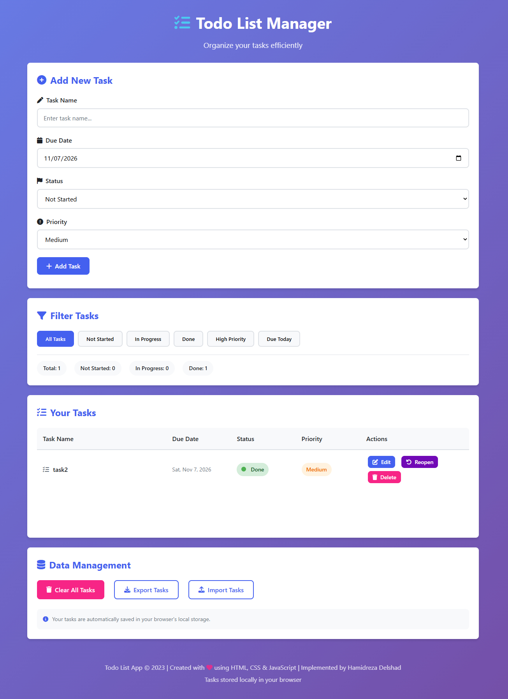

# Todo List Application

A modern, feature-rich Todo List web application built with HTML, CSS, and JavaScript that allows users to manage tasks efficiently with CRUD operations and localStorage persistence.

## ✨ Features

### ✅ Core Features

- **Add Tasks**: Create tasks with name, due date, status, and priority
- **Edit Tasks**: Modify existing tasks with full form editing
- **Complete/Reopen Tasks**: Toggle task completion status
- **Delete Tasks**: Remove tasks with confirmation dialog
- **Filter Tasks**: Filter by status (All, Not Started, In Progress, Done), priority, or due today
- **LocalStorage Persistence**: Tasks are automatically saved and persist across browser sessions

### 🎨 UI/UX Features

- **Modern Design**: Clean, responsive interface with gradient background
- **Visual Status Indicators**: Color-coded status badges (Not Started, In Progress, Done)
- **Priority Levels**: Low (green), Medium (orange), High (red) priority indicators
- **Real-time Statistics**: Live counters for total tasks and status breakdown
- **Interactive Notifications**: Toast notifications for user actions
- **Mobile Responsive**: Fully responsive design for all screen sizes

### 📱 Advanced Features

- **Import/Export**: Export tasks to JSON file or import from existing JSON data
- **Bulk Operations**: Clear all tasks with confirmation
- **Form Validation**: Input validation with user-friendly error messages
- **Keyboard Support**: Form submission with Enter key
- **FontAwesome Icons**: Visual icons throughout the interface

## 🛠️ Technology Stack

- **HTML5**: Semantic markup and modern structure
- **CSS3**: Custom properties (CSS variables), Flexbox, Grid, animations
- **JavaScript (ES6+)**: Class-based architecture, localStorage API, DOM manipulation
- **FontAwesome 6**: Icon library for enhanced UX
- **LocalStorage**: Client-side data persistence

## 📋 Project Structure

```
ISA6_TodoList/
├── index.html          # Main application interface
├── style.css           # Styles and responsive design
├── javascript.js       # Application logic (700+ lines)
├── README.md           # Project documentation (this file)
├── screenshots/        # Screenshots folder
│   └── todoform.png    # Sample screenshot
└── img/               # Images directory
    └── back.jpg       # Background image
```

## 🚀 Getting Started

### Local Development

1. Clone or download the project files
2. Open `index.html` in any modern web browser
3. No build process or dependencies required

### Usage Instructions

1. **Adding a Task**:
   - Fill in the task name, due date, select status and priority
   - Click "Add Task" or press Enter

2. **Managing Tasks**:
   - **Edit**: Click the Edit button on any task
   - **Complete/Reopen**: Click the Complete/Reopen button
   - **Delete**: Click the Delete button (with confirmation)
   - **Filter**: Use the filter buttons to view specific task categories

3. **Data Management**:
   - **Export**: Click "Export Tasks" to download all tasks as JSON
   - **Import**: Click "Import Tasks" and paste JSON data
   - **Clear All**: Click "Clear All Tasks" to remove all tasks

## 📝 Implementation Details

### Task Data Structure

```javascript
{
  id: "unique-generated-id",
  name: "Task name",
  date: "YYYY-MM-DD",
  status: "not-started|in-progress|done",
  priority: "low|medium|high",
  createdAt: "ISO timestamp",
  updatedAt: "ISO timestamp"
}
```

### localStorage Integration

- **Key**: `todoTasks`
- **Format**: JSON array of task objects
- **Auto-save**: All CRUD operations automatically save to localStorage
- **Auto-load**: Tasks load from localStorage on application startup

### Validation Rules

1. Task name is required and must be unique
2. Due date is required and cannot be in the past
3. Default status: "Not Started"
4. Default priority: "Medium"

## 🎯 Design Principles

### Color Scheme

- **Primary**: `#4361ee` (Blue)
- **Success**: `#4cc9f0` (Cyan)
- **Danger**: `#f72585` (Pink)
- **Warning**: `#ff9e00` (Orange)
- **Status Colors**:
  - Not Started: Red theme
  - In Progress: Orange theme
  - Done: Green theme

### Responsive Breakpoints

- **Mobile**: < 768px (single column layout)
- **Tablet**: 768px - 1024px (adaptive layout)
- **Desktop**: > 1024px (full grid layout)

## 📸 Screenshots

### Main Interface



### Features Showcase

- Modern card-based design
- Task filtering system
- Status and priority badges
- Data management controls

## ✅ Requirements Fulfillment

| Requirement                 | Status | Implementation                    |
| --------------------------- | ------ | --------------------------------- |
| Task has name, date, status | ✅     | Plus priority field               |
| Unique task names           | ✅     | Case-insensitive validation       |
| Form validation             | ✅     | Real-time with notifications      |
| Status-based colors         | ✅     | Color-coded badges                |
| Delete functionality        | ✅     | With confirmation dialog          |
| Custom styling              | ✅     | Modern, responsive design         |
| localStorage persistence    | ✅     | Cross-session data retention      |
| CRUD operations             | ✅     | Full Create, Read, Update, Delete |
| Task filtering              | ✅     | Multiple filter options           |
| Import/Export               | ✅     | JSON data management              |

## 🔧 Browser Compatibility

- ✅ Chrome (latest)
- ✅ Firefox (latest)
- ✅ Safari (latest)
- ✅ Edge (latest)
- ✅ Mobile browsers

## 📄 License

This project is created for educational purposes. Feel free to use and modify as needed.

## 👤 Author

**Hamid Swed**  
[GitHub Profile](https://github.com/hamidswed)  
[Live Demo](https://isa-6-todo-list.vercel.app)

---

**Last Updated**: November 2026  
**Version**: 1.0.0
